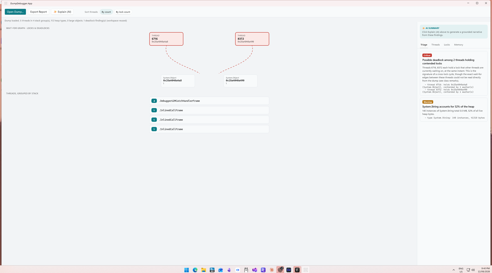
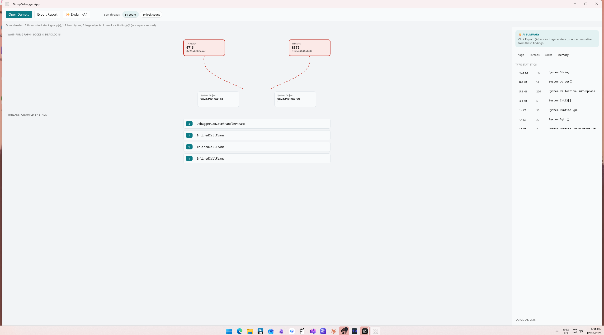

# Dump Debugger

[](https://vibecoded.fyi/)

Dump Debugger is a native Windows application for investigating .NET memory dumps. It turns the manual WinDbg command-grind — `!threads`, `!syncblk`, `!dumpheap -stat`, `!gcroot` held together in your head — into a guided, cross-linked workbench that proposes conclusions instead of just raw data.



## Leads with conclusions, not commands

Deterministic analyzers walk the dump and produce a ranked list of findings — deadlocks, heap composition, thread state — each with the evidence behind it, so you see what's actually wrong before you go digging.

- **Deadlock detection.** Enumerates sync blocks, builds the wait-for relation between threads, and flags contended-lock cycles automatically — the classic two-thread, two-lock deadlock shows up as a critical finding the moment the dump opens.
- **Wait-for graph.** The threads and locks behind a deadlock are drawn as a graph — who holds what, who's waiting on whom — instead of a wall of hex addresses.
- **Stack grouping.** Threads sharing an identical stack collapse into one row with a count, so 200 threads blocked in the same place read as one line, not two hundred.
- **Operation context.** Walks each thread's stack for the unit of work it's doing — an ASP.NET request's method and path when available, otherwise the deepest application frame — so "thread 47 is blocked" becomes "thread 47 is serving `POST /api/orders/checkout` and is blocked."
- **Heap composition and object identification.** Type statistics ranked by total size, plus large-object identification that reads a big object's own fields (strings, anything named `Id`/`Name`/`Key`/`Path`) instead of reporting `byte[] — 84 MB` and leaving you to guess what it is.
- **Triage.** All findings from every analyzer, ranked by severity, as the landing view — critical deadlocks first, informational notes last.
- **Report export.** Writes the current investigation — findings and evidence — to Markdown for a ticket or a post-mortem.
- **Workspace persistence.** Opening a dump creates a sidecar workspace folder that caches its findings, so reopening the same dump is instant.

## Type statistics and large-object identification



## Runtime coverage

Built on [ClrMD](https://github.com/microsoft/clrmd) (the library SOS itself is built on) rather than shelling out to WinDbg, so field values come back typed instead of parsed from text tables. Supports .NET Framework 4.8, .NET 6, and .NET 8+, across x86 and x64 — ClrMD requires the analyzing process to match the dump's architecture, so Dump Debugger launches an x86 or x64 worker process based on what the dump actually is.

DACs are never bundled — they're resolved at runtime from the dump itself, the local machine, an app-managed cache, or (opt-in) the Microsoft symbol server, in that order.

## Open a dump

- Open a `.dmp` file directly.
- Or generate a test fixture locally with the bundled `DumpDebugger.DumpGen` tool (see below).

## Run locally

Requires Windows, the .NET 10 SDK, Node 20+, and the WebView2 runtime (ships with Windows 11).

```bash
# 1. Workers: ClrMD must match the dump's bitness, so build both.
dotnet build src/DumpDebugger.Worker -r win-x64
dotnet build src/DumpDebugger.Worker -r win-x86

# 2. Web app (React + TypeScript, served to the host's WebView2).
cd web && npm install && npm run build && cd ..

# 3. Host (WinUI 3 + WebView2). Copies web/dist and both workers next to the exe.
dotnet build src/DumpDebugger.Host -p:Platform=x64
```

Then run `src/DumpDebugger.Host/bin/x64/Debug/net10.0-windows10.0.26100.0/win-x64/DumpDebugger.Host.exe`, optionally with a dump path as the first argument.

For hot reload while working on the UI, start `npm run dev` in `web/` and launch the host with `DUMPDEBUGGER_WEB_URL=http://localhost:5173`.

To generate a test dump for exploring the app:

```bash
dotnet run --project src/DumpDebugger.DumpGen -- ./fixtures/deadlock.dmp --scenario deadlock
```

`--scenario deadlock` produces a real two-thread, two-lock deadlock; omit it (or pass `simple`) for a plain heap fixture.

## Tests

```bash
dotnet test src/DumpDebugger.Tests     # missing fixtures are generated with DumpGen on first run
cd web && npm test && npm run lint
```

Contract types are generated, not hand-written: after changing anything in `DumpDebugger.Core` that crosses the bridge, run `npm run gen:types` in `web/`. A test fails if `web/src/contracts.gen.ts` is stale.

## Project layout

| Project | Purpose |
|---|---|
| `DumpDebugger.Core` | Domain model, findings schema, RPC catalog and contracts. No ClrMD dependency |
| `DumpDebugger.Analysis` | ClrMD-backed dump loading, DAC resolution, all analyzers |
| `DumpDebugger.Worker` | Thin JSON-RPC host around `DumpDebugger.Analysis`, built as x86 and x64 |
| `DumpDebugger.Session` | Host-side services with no UI: worker lifecycle, the bridge dispatcher, workspace |
| `DumpDebugger.Host` | WinUI 3 window hosting WebView2; serves `web/dist` and bridges it to `Session` |
| `web/` | The UI: React + TypeScript (Vite) |
| `tools/DumpDebugger.TsGen` | Generates `web/src/contracts.gen.ts` from Core's RPC catalog |
| `DumpDebugger.DumpGen` | Test-fixture generator used above |

See [docs/PLAN.md](docs/PLAN.md) for the original design rationale and [docs/redesign/](docs/redesign/) for the redesign.
