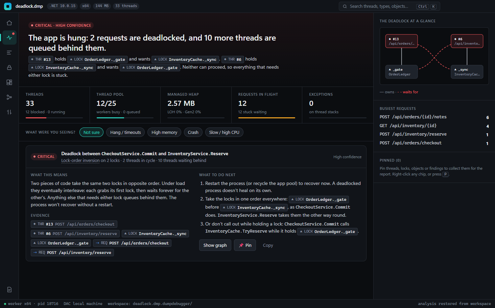
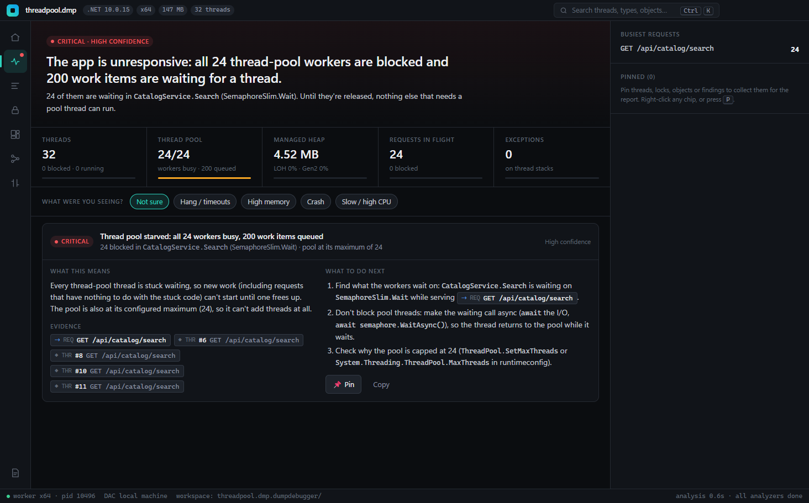
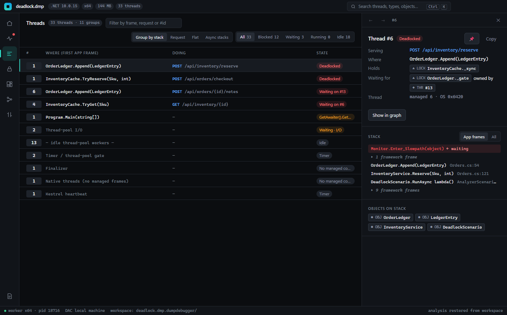
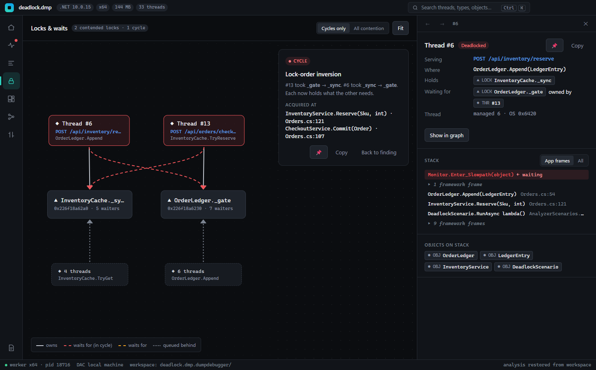
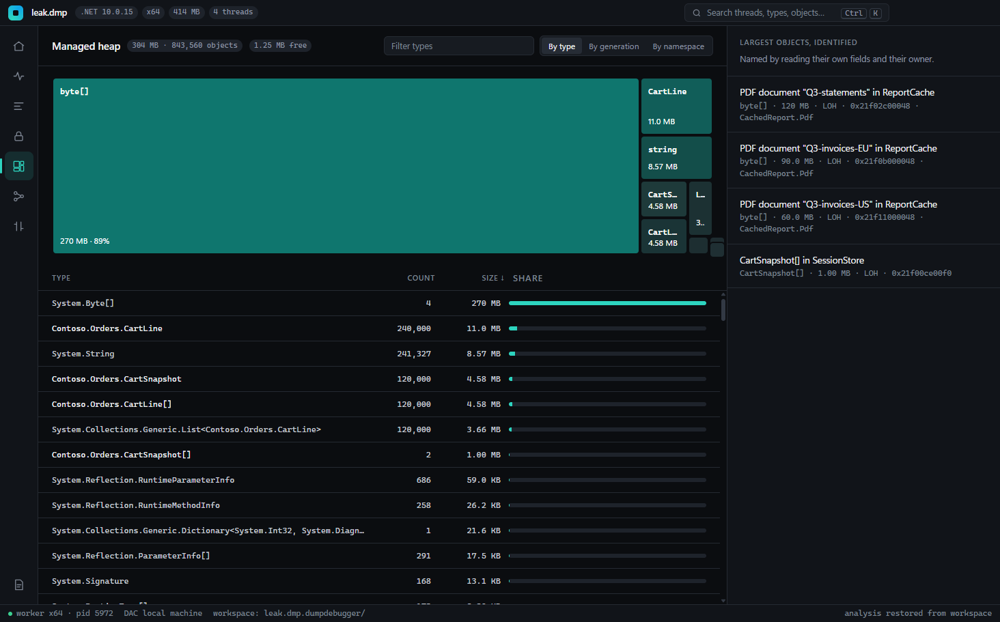
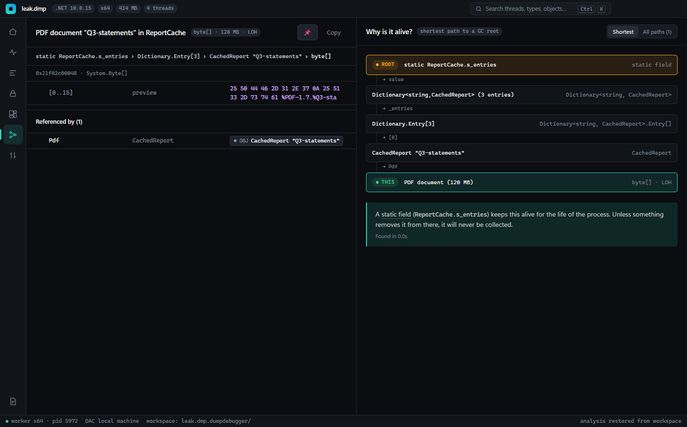
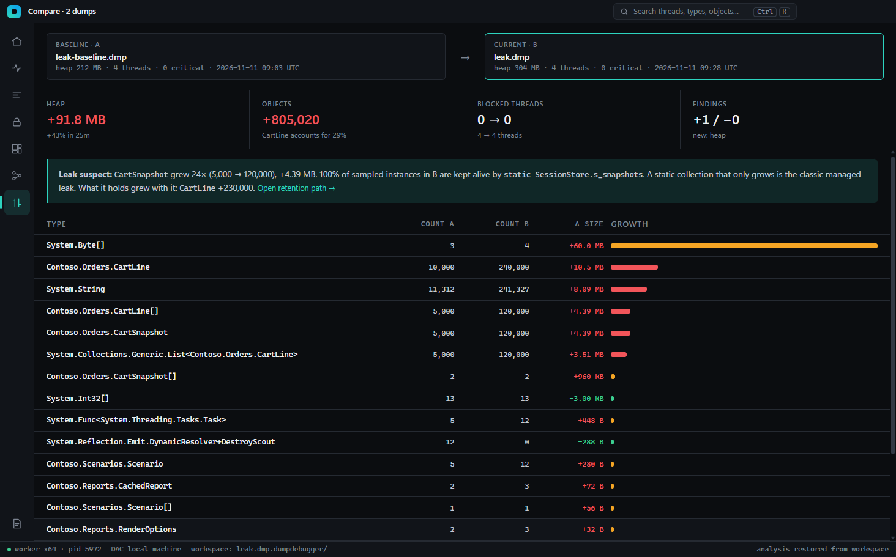
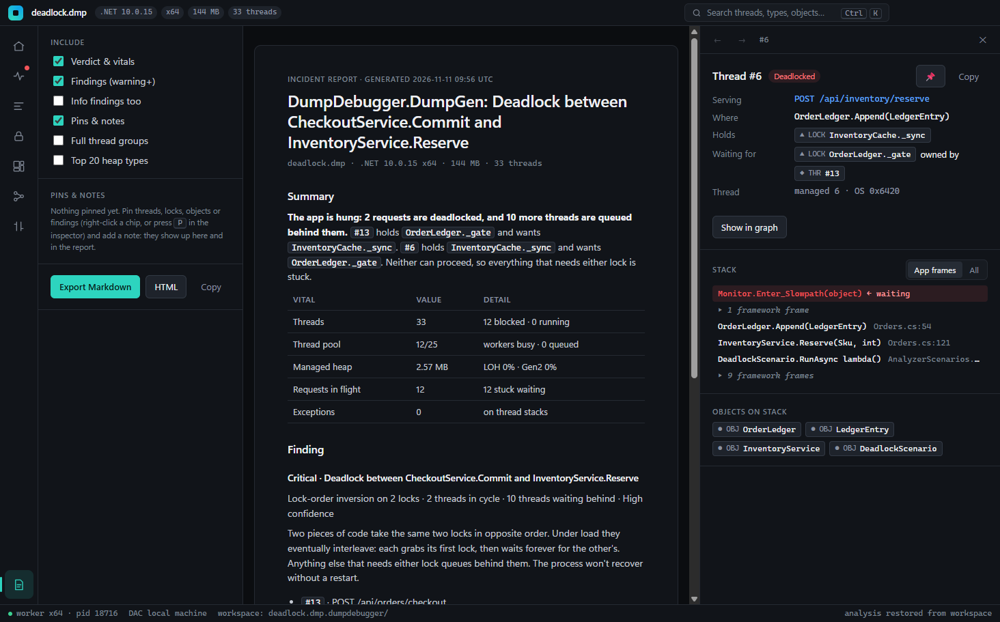
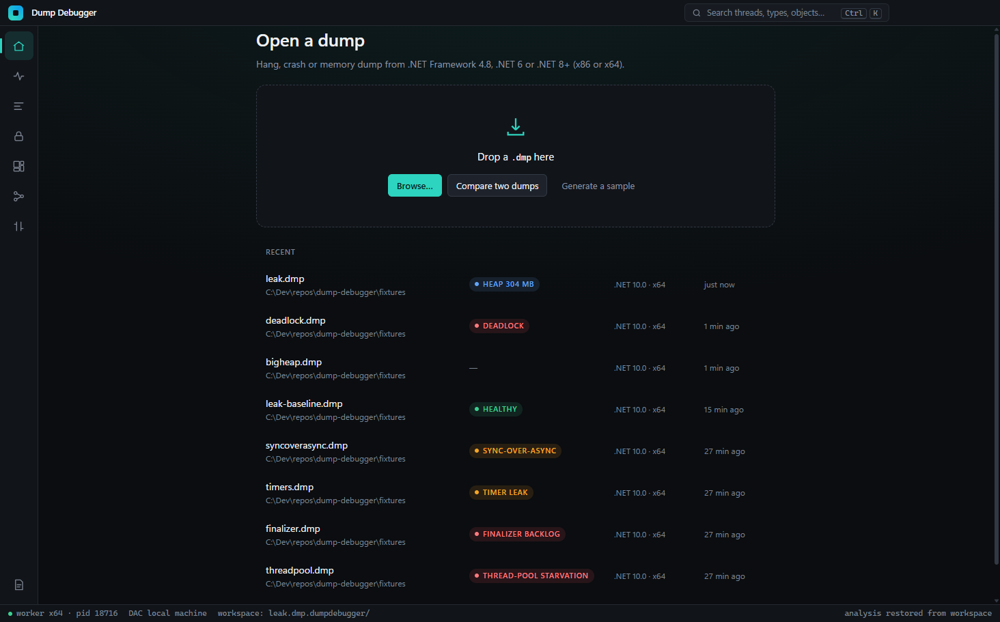
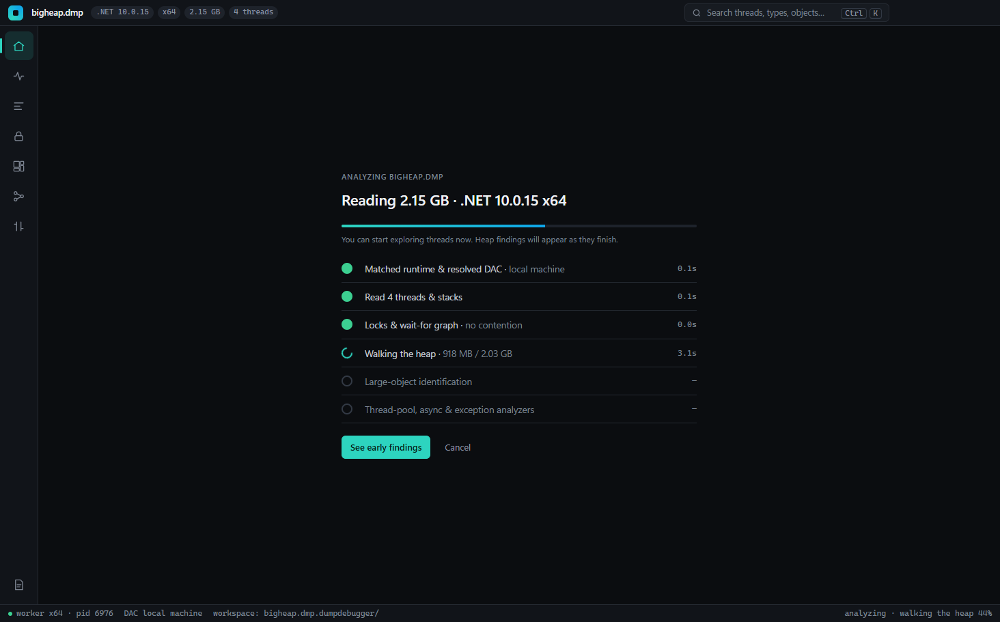

# Dump Debugger

[](https://vibecoded.fyi/)

Dump Debugger is a Windows app for investigating .NET memory dumps, built for the on-call developer with a hang dump at 2 a.m. and no WinDbg muscle memory. It opens with a **verdict in plain English**, says **what it means and what to do next**, and backs every claim with evidence you can click through: thread, lock, object, and the path that keeps it alive.



## Plain answers first, every byte one click away

- **A verdict, not a wall of hex.** "The app is hung: 2 requests are deadlocked, and 10 more threads are queued behind them." Each finding carries *what this means*, *what to do next* (templated from the evidence, never free-form), a confidence level, and the threads, locks, objects and requests it's about.
- **"What were you seeing?"** Hang, high memory, crash or slow: the symptom chips re-rank findings toward what you noticed.
- **Everything is a link.** Threads ◆, locks ▲, objects ●, types and requests are one chip style. Click any of them and it opens in the inspector (with back/forward), or jump anywhere with <kbd>Ctrl</kbd>+<kbd>K</kbd>.
- **Names from your code.** Threads are grouped by their first *application* frame (`InventoryCache.TryReserve(Sku, int)`, not `.InlinedCallFrame`), locks by the field that holds them (`OrderLedger._gate`), requests by route (`POST /api/orders/{id}/notes`), with source lines when PDBs are next to the binaries.
- **Teaches in place.** Jargon like *GC root* or *Large Object Heap* has a dotted underline with a definition, and the glossary is one key away (<kbd>?</kbd>).

## What it finds

Deterministic analyzers, each with authored explanations and a test fixture:

| Analyzer | Finds |
|---|---|
| Deadlocks | Lock cycles with exact wait-for edges, the order each side took its locks, and everything queued behind them |
| Lock convoys | Locks with a queue of waiters, and what the owner is doing meanwhile |
| Thread-pool starvation | Every worker blocked, work items queued (read from the pool's own queues) |
| Sync-over-async | Threads blocked on `.Result` / `.Wait()` / `GetAwaiter().GetResult()` |
| Async logical stacks | Pending `async` operations reconstructed from state machines, grouped by what they await |
| Exceptions | Crashes (unhandled exception), exceptions in flight on threads, exception storms and what keeps them |
| Finalizer backlog | A blocked finalizer thread and the objects piling up behind it |
| Heap dominance | One type owning the heap, named by its largest instances ("mostly 3 PDF documents in ReportCache") |
| LOH fragmentation | Free space trapped between large objects |
| HttpClient per call | Hundreds of clients, handlers and sockets, and the method creating them |
| Timer leaks | Thousands of timers, grouped by the callback they'll run and who holds them |



## Views

**Threads**: grouped by stack, request, or flat; state filters; app-first stacks with framework frames folded; holds/waits; objects on the stack. **Async stacks** show operations that aren't on any thread.



**Locks**: the wait-for graph (React Flow + ELK), cycles in red, queued-behind clusters, and the lock order explained.



**Memory and Objects**: treemap and type table, the largest objects named by their content and owner, and an object explorer with typed fields, "referenced by", and **why it's alive** (shortest or all paths to a GC root).




**Compare**: baseline vs. current from cached snapshots (the baseline is never reopened): type deltas, thread-group deltas, findings that appeared or resolved, and **leak suspects** with a drill-down into the retention path.



**Report**: pin anything with a note (kept in the dump's workspace sidecar), then export an incident report as Markdown or a self-contained HTML page. The preview is the export.



**Home and Analyzing**: drag-drop or browse, recents with their last verdict, a sample generator for every scenario, and named analysis stages instead of a spinner (threads are explorable before the heap walk finishes).




## How it's built

```
web/ (React + TS, Vite)  ── JSON-RPC over postMessage ──  DumpDebugger.Host (WinUI 3 + WebView2)
                                                             ── JSON-RPC over a named pipe ──  Worker x86 / x64
                                                                                                 └─ Analysis (ClrMD) + Core
```

- **ClrMD, not WinDbg.** Field values come back typed instead of parsed from text. Supports .NET Framework 4.8, .NET 6 and .NET 8+, x86 and x64. ClrMD must match the dump's bitness, so the host sniffs the minidump header and launches an x86 or x64 worker.
- **DACs are never bundled.** They're resolved from the dump, the machine, an app cache, or (opt-in) the Microsoft symbol server.
- **The worker aggregates and pages.** Nothing ships a raw heap over the bridge: the UI asks for what's on screen. A compact reverse-reference index (built in parallel, ~3 s for a 2 GB / 12M-object heap) makes referrers and root paths near-instant.
- **One contract.** `DumpDebugger.Core`'s RPC catalog drives both the host dispatcher and the generated TypeScript types (`web/src/contracts.gen.ts`).
- **Workspaces.** Opening a dump creates `<dump>.dumpdebugger/` next to it (or under `%LOCALAPPDATA%` if that folder isn't writable) with the cached diagnosis, the compare snapshot, and your pins and notes. Reopening is instant.

## Run locally

Requires Windows, the .NET 10 SDK, Node 20+, and the WebView2 runtime (part of Windows 11).

```bash
# 1. Workers: ClrMD must match the dump's bitness, so build both.
dotnet build src/DumpDebugger.Worker -r win-x64
dotnet build src/DumpDebugger.Worker -r win-x86

# 2. The web app (served to the host's WebView2).
cd web && npm install && npm run build && cd ..

# 3. The host. Picks up web/dist, both workers, and DumpGen for "Generate a sample".
dotnet build src/DumpDebugger.DumpGen
dotnet build src/DumpDebugger.Host -p:Platform=x64
```

Then run `src/DumpDebugger.Host/bin/x64/Debug/net10.0-windows10.0.26100.0/win-x64/DumpDebugger.Host.exe`, optionally with a dump path as the first argument.

For hot reload while working on the UI, run `npm run dev` in `web/` and start the host with `DUMPDEBUGGER_WEB_URL=http://localhost:5173`.

### Test dumps

`DumpDebugger.DumpGen` captures real dumps of real problems (most are an ASP.NET Core app under HTTP load):

```bash
dotnet run --project src/DumpDebugger.DumpGen -- --list
dotnet run --project src/DumpDebugger.DumpGen -- ./fixtures/deadlock.dmp --scenario deadlock
```

Scenarios: `deadlock`, `threadpool`, `syncoverasync`, `exceptions`, `crash`, `finalizer`, `leak` and `leak-baseline` (compare them), `loh`, `httpclient`, `timers`, `bigheap` (2 GB performance fixture), `simple`. The same list is behind **Generate a sample** on Home.

## Tests

```bash
dotnet test src/DumpDebugger.Tests          # missing fixtures are generated with DumpGen on first run
DUMPDEBUGGER_PERF=1 dotnet test src/DumpDebugger.Tests -c Release   # + the 2 GB root-path timing
cd web && npm test && npm run lint && npm run typecheck
```

Every analyzer has a golden snapshot of what it says about its scenario (`src/DumpDebugger.Tests/Golden/`; `UPDATE_GOLDEN=1` to accept a deliberate change). After changing a contract in `DumpDebugger.Core`, run `npm run gen:types` in `web/`; a test fails if the generated TypeScript is stale.

`web/scripts/shot.mjs` drives the real app over WebView2's DevTools port to take screenshots and run axe-core accessibility checks (`--cdp <port>` on the host).

## Package

```powershell
./build/package.ps1            # signed MSIX in artifacts/msix (self-contained: no .NET install needed)
./build/package.ps1 -Install   # also installs it (elevated: trusts the dev certificate; otherwise Developer Mode)
```

The script creates a self-signed development certificate (`CN=Dump Debugger Dev`) on first run. To ship to other machines, pass a real code-signing certificate with `-CertificatePath` and match its subject in `src/DumpDebugger.Host/Package.appxmanifest`.

## Project layout

| Project | Purpose |
|---|---|
| `src/DumpDebugger.Core` | Contracts (findings, entities, threads, locks, memory, compare), the RPC catalog and framing. No ClrMD |
| `src/DumpDebugger.Analysis` | ClrMD: dump loading and DAC resolution, thread/lock/heap models, the reference index and object explorer, every analyzer, the verdict |
| `src/DumpDebugger.Worker` | JSON-RPC host around Analysis, built for x86 and x64 |
| `src/DumpDebugger.Session` | Host-side services with no UI: worker lifecycle, the bridge dispatcher, workspaces, recents, pins, compare |
| `src/DumpDebugger.Host` | WinUI 3 window hosting WebView2; serves `web/dist` and bridges it to Session; MSIX manifest |
| `web/` | The UI: React + TypeScript (Vite), TanStack Query/Virtual, React Flow + ELK |
| `tools/DumpDebugger.TsGen` | Generates `web/src/contracts.gen.ts` from Core |
| `src/DumpDebugger.DumpGen` | Fixture generator: real dumps of real problems |
| `src/DumpDebugger.Tests` | Golden analyzer snapshots, bridge, compare, pins/report, perf |

See [docs/redesign/](docs/redesign/) for the design (`design.html`) and the roadmap with implementation notes, and [docs/PLAN.md](docs/PLAN.md) for the original architecture rationale.
